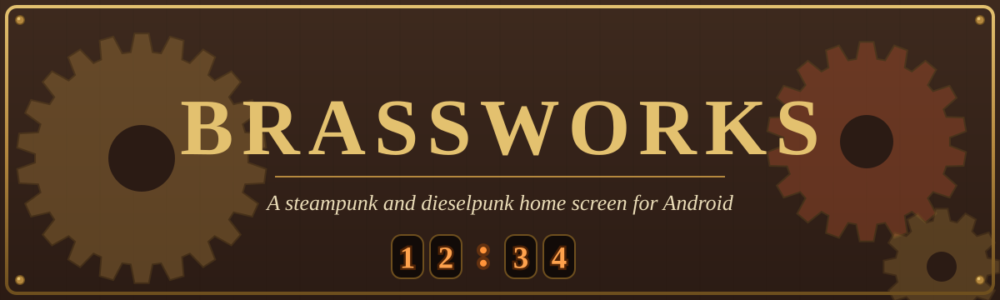
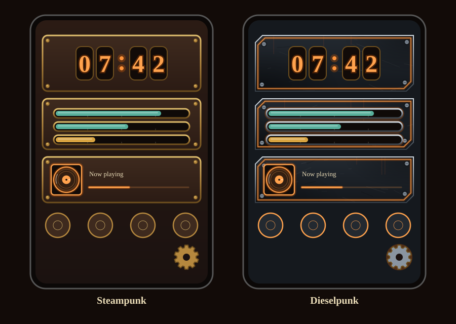
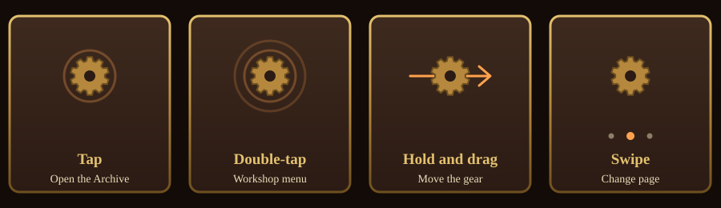
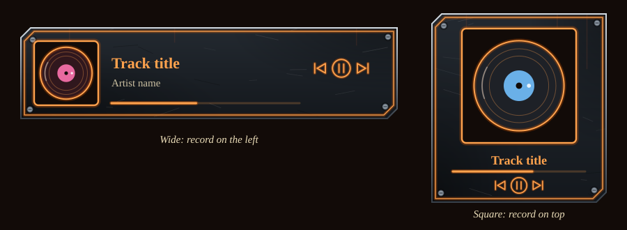
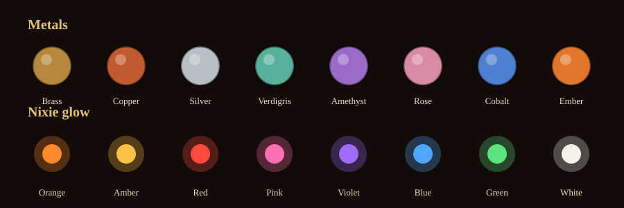

  

  <b>Brassworks</b> replaces your Android home screen with a world of brass, rivets and glowing nixie tubes, 
  or, at the flip of a switch, gunmetal panels and neon.

  
  
  

> **A note on the pictures.** The images in this README are drawn illustrations of the look, not screenshots.
> The real thing is a little different on every phone.

---

## ⚙️ What you get

| | |
|---|---|
| 🏠 **A real launcher** | Every installed app, a searchable Archive, app shortcuts, hidden apps and folders. |
| 🕰️ **Widgets with character** | Nixie-tube clocks, boiler and cargo gauges, glass vials, a neon record player, a calendar, a notepad and a working map of the planets. |
| 🎨 **Two styles** | Steampunk (wood and brass) or Dieselpunk (steel and neon). Switch any time; nothing is lost. |
| 🖌️ **Your colours** | Eight metals, eight nixie glows, or mix your own with sliders. |
| 📑 **Pages and grids** | Up to eight pages, snapping grids and layout presets that can carry your colours and wallpaper. |
| 🔒 **Private** | No accounts, no ads and no internet needed for the widgets. Nothing leaves your phone. |

  

---

## 📲 Install

Brassworks needs **Android 8.0 or newer**. There is no app-store release yet, so you build it with GitHub (no Android Studio needed):

1. Copy this repository to your own GitHub account (fork it, or upload the folder, keeping the hidden `.github` folder).
2. Open the **Actions** tab and run **Build APK**. It also runs on every push.
3. When it finishes, download the `brassworks-apk` artifact, unzip it and install `app-debug.apk`. Android will ask you to allow installs from unknown sources.

### Make it your home screen
Press the Home button and choose **Brassworks → Always**, or go to *Settings → Apps → Default apps → Home app*. To go back, pick your old launcher in the same place.

---

## 🧭 Getting around

  

- **The floating gear** opens the Archive with a tap and the **Workshop** menu (Arrange, Presets, Pages, Settings) with a double-tap. Hold it and drag to put it anywhere; portrait and landscape remember their own spot.
- **The Archive** lists every app, with letter-strip jumping. Long-press an app to add it to the App shelf or a folder, hide it, see its shortcuts, open its info or uninstall it.
- **Arrange mode** (Workshop → Arrange, or press and hold empty space): drag widgets to move them, pull the bottom-right corner to resize, tap the red ✕ to remove, tap the brass cog for that widget's own settings.
- **Pages:** swipe left and right, or tap the dots. Home always returns to page 1.

### Search tricks
- **Fuzzy search:** `gm` finds Google Maps and `clndr` finds Calendar.
- **Calculator:** type `18*4+6` or `(2+3)^2` and tap the answer to copy it.
- **Web fallback:** if nothing matches, tap to search DuckDuckGo.

---

## 🧰 Widgets

| Widget | What it does |
|---|---|
| 🕰️ **Nixie clock / Nixie tubes** | Glowing tubes, with or without the date. The analogue **Brass dial** is there too. |
| ⏱️ **Time plaque** | A plain, readable time and date. |
| 🔋 **Boiler pressure** | Battery level as a pressure gauge. |
| 📦 **Cargo hold** | Storage used. |
| 🧪 **Vials** | Up to six glass tubes: battery, storage, memory, heat, air pressure and how much of today has passed. |
| 🎵 **Music player** | A neon record player with working controls (see below). |
| ⚙️ **Engine room** | Dials for memory, battery heat and network flow. |
| 🪐 **Solar system** | A top-down map of the planets where they really are today. |
| 📅 **Almanac** | Calendar. |
| 📝 **Memorandum** | A notepad. |
| 🧭 **App shelf, Folders, Link folders** | Your apps, grouped apps, and web links. |
| 🔧 **Chief Engineer's picks** | Your most-used apps. |

Every widget has its own settings: hour format, Celsius or Fahrenheit, a title of your own, panel opacity (down to 20% so your wallpaper shows through), and a *move to page* option.

### 🎵 The music player

  

- **Resize it** to change shape: wide and short gives a strip, taller gives a square card.
- The **record** spins while music plays and takes a new random tint with each track.
- **Previous, play/pause and next** control whichever music app is playing, and need no permission.
- The neon colour follows your **Nixie glow** choice.
- **Track title, artist and the thin progress line** need **Notification access**, which you switch on once (the widget's tap prompt or cog takes you there). Because Brassworks is installed from outside the Play Store, Android may first ask you to *allow restricted settings* in its App info.
- **Privacy:** Brassworks reads only the media information (track, artist and position) and nothing else. It never leaves your phone.

### 🪐 The solar system
Planet positions are worked out on the phone from JPL's published orbit tables, with no internet needed, and are good to about half a degree. Tap a planet for its distance from the Sun and Earth, how long light takes to arrive and the length of its year. Tap the Sun to switch between the inner system (to scale) and the whole system.

---

## 🎨 Make it yours

### Styles
**Settings → Look → Style** changes the whole launcher at once.

- **Steampunk:** dark wood, brass, leather and rivets.
- **Dieselpunk:** gunmetal panels with cut corners, a neon line set in from the edge, scratches and oil streaks, steel bolts and a riveted plate background. The neon takes your Nixie glow colour.

### Colours

  

- **Metals:** Brass, Copper, Silver, Verdigris, Amethyst, Rose, Cobalt, Ember.
- **Nixie glow:** Orange, Amber, Red, Pink, Violet, Blue, Green, White.
- **Your own colours:** sliders for Hue, Strength and Brightness for the metal, the background and the neon. They stay in readable ranges.

### Fonts and wallpaper
- Fonts: Classic, **Victorian** (Old Standard TT), Script, Plain, Typewriter, or load your own `.ttf` / `.otf`.
- Wallpaper: pick a picture and use the slider to darken it so text stays readable.
- Gear speed: Slow, Normal or Fast.

### Pages, grids and presets
- **Pages:** up to eight, each with its own widgets.
- **Fixed grid** (on by default): widgets snap into cells and never overlap. Choose **Auto**, **5 × 10** or **4 × 9** (they turn with the phone). Turn the grid off to let widgets float anywhere.
- **Presets:** four built-ins (Classic, Minimal, Engineer, Planner) plus your own. A preset can also remember your colours and style and a private copy of your wallpaper, and applying one saves a **Previous layout** so you can undo it.
- **Share and import:** send a layout (and colours) as a text code to another phone. Wallpapers are never shared.

---

## 🔐 Permissions and privacy

| Permission | Why |
|---|---|
| Notification access (optional) | Lets the Music player show the track, artist and progress. Off by default. |
| Package queries | Lists the apps you have installed, to show them in the Archive. |

Brassworks has no analytics and no accounts. Hiding an app only tidies the view; it is not a lock.

---

## 🛠️ For developers

- Kotlin 2.0, Jetpack Compose (BOM 2024.09), Material 3, Android Gradle Plugin 8.5, Gradle 8.9, JDK 17.
- `minSdk 26`, `targetSdk` and `compileSdk 34`, package `com.steampunk.brassworks`.
- A single activity. The code is split into a few files that must all be present:

| File | Contents |
|---|---|
| `Launcher.kt` | The launcher, widget board, Archive, Workshop and Settings |
| `Components.kt` | Shared panels, the gear button and the backdrop |
| `Theme.kt` | Palettes, styles, custom colours and wallpaper helpers |
| `Look.kt` | Colour sliders and the look saved inside presets |
| `Music.kt` | The Music player and its notification listener |
| `Vials.kt` | The Vials widget |
| `WidgetSettings.kt` | Per-widget settings |
| `LinkFolder.kt` | Link folders |
| `SolarSystem.kt` | The planet map |
| `About.kt` | Help and credits |

- **Fonts:** the workflow downloads the three Old Standard TT files into `app/src/main/assets/fonts/` during the build. You can also place `OldStandard-Regular.ttf`, `OldStandard-Bold.ttf` and `OldStandard-Italic.ttf` there yourself. Without them, the Victorian choice explains the font is missing and Classic stays on.
- The repository's to-do list is in [`TODO.md`](TODO.md).

---

## 🙏 Credits

- **Old Standard TT**, Copyright 2011 The Old Standard Project Authors, used under the [SIL Open Font License 1.1](https://openfontlicense.org).
- Planet positions use orbit tables published by NASA's Jet Propulsion Laboratory. Sunrise and moon calculations are credited in the app under *Settings → System → Credits*.

<i>Ruthlessness is mercy upon ourselves. Adapt to the times, and fight for what is right.</i>

